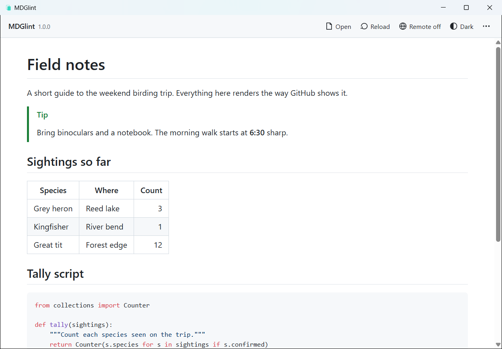
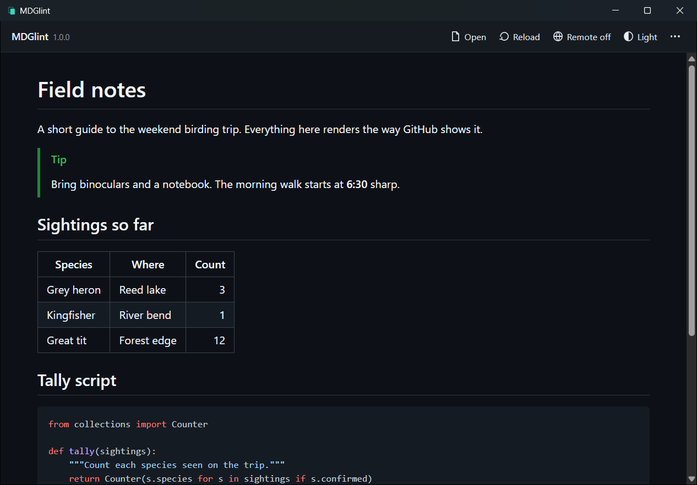

# MDGlint

A fast, no-fuss Markdown app for Windows. Double-click a `.md` file and see it rendered with
GitHub-style formatting, in light or dark mode.

MDGlint starts instantly and stays out of your way: open a file, read it, and the preview
refreshes whenever the file is saved. Export, diagrams, tabs, quick inline edits and more are on
the [roadmap](docs/roadmap.md).

<p>
  
  
</p>

## Features

- Opens `.md` and `.markdown` files by double-click (after setting MDGlint as the default app),
  from the Open button (also on the page shown when no file is open), or by dragging a file
  onto the window.
- Copy a code block with its Copy button, or the whole file's Markdown with **Copy Markdown**
  (Ctrl+Shift+C) in the **⋯** menu.
- Print (Ctrl+P), or export to PDF or to one self-contained HTML file, from the **⋯** menu. Printouts and PDFs use the light theme
  unless you turn that off in the same menu.
- GitHub-flavoured Markdown via [Markdig](https://github.com/xoofx/markdig): tables, task lists,
  footnotes, autolinks, and the rest of Markdig's advanced extensions.
- GitHub's Markdown styling ([github-markdown-css](https://github.com/sindresorhus/github-markdown-css))
  in light and dark themes. The choice is remembered between launches.
- Syntax highlighting for fenced code blocks that name a language, using
  [highlight.js](https://highlightjs.org/) with its GitHub themes.
- GitHub-style alerts (`> [!NOTE]`, `> [!WARNING]` and the rest).
- Live reload: the preview refreshes when the file changes on disk.
- Images load from relative paths (including `../`) and from absolute paths on any drive or
  network share.
- Links to other Markdown files open in MDGlint; web links open in your default browser; links
  to any other file on your PC show it in Explorer rather than running it.
- Remote images, video and audio are blocked until you allow them, for one file or always.
- Opens maximized the first time, then as you left it: maximized or not, size and position.
- Optional update checks: once a day, MDGlint can ask GitHub whether a newer version is out.
  It only installs one when you press **Install**, after checking the download's SHA-256.

MDGlint is not affiliated with or endorsed by GitHub.

## Install

1. Download `MDGlintSetup.exe` from the
   [latest release](https://github.com/Jawad-Chughtai/MDGlint/releases/latest).
2. Run it. By default it installs for you only, with no administrator prompt; choose
   **Install for all users** instead to install to Program Files (needs administrator rights).
3. Optionally tick **Associate .md and .markdown files with MDGlint** during setup. Windows may
   still ask once which app to use the first time you open each type; pick **MDGlint** and
   **Always**.
4. Optionally tick **Check for updates once a day**. You can turn it on or off later from the
   **⋯** menu in MDGlint's toolbar, which also has **Check for updates now**.

### Updating

When a newer version is out (found by the daily check or by **Check for updates now**), a bar
says so. **Install** downloads the new installer, checks it against the release's SHA-256,
closes MDGlint, installs the update and opens MDGlint again; nothing is installed until you
press it. You can update from any older version straight to the latest one. You can also
download the latest installer yourself and run it over your installed copy.

To test new versions early, turn on **Get beta versions** in the **⋯** menu. The check then
also offers pre-releases (`1.2.0-beta.1`), with the same SHA-256 check. A beta is offered only
when it is for a newer version than the latest stable release; once that version is released
as stable (`1.2.0`), the stable one is offered instead of its betas. Turning it off never goes back to an older version: you stay on the beta until
a newer stable version is out. Versions before 1.1 can't see betas, so download the first one
yourself from the [releases page](https://github.com/Jawad-Chughtai/MDGlint/releases).

> **Windows SmartScreen:** the installer is not code-signed yet, so Windows may show
> "Windows protected your PC". Choose **More info**, then **Run anyway**. You can check the
> download against the SHA-256 hash published on the release page, or, with the
> [GitHub CLI](https://cli.github.com/), confirm it was built by this repository's release
> workflow: `gh attestation verify MDGlintSetup.exe -R Jawad-Chughtai/MDGlint`.

### Make MDGlint the default for Markdown files

If you skipped the association during setup, or Windows still opens another app:

1. Right-click any `.md` file and choose **Open with** > **Choose another app**.
2. Pick **MDGlint** and select **Always**.

Repeat for `.markdown` files if you use that extension. MDGlint is listed for both types
either way.

## Requirements

- Windows 10 (version 1607 or later) or Windows 11, x64. Setup refuses older Windows.
- [Microsoft Edge WebView2 Runtime](https://developer.microsoft.com/microsoft-edge/webview2/).
  It ships with Windows 11 and nearly every Windows 10 machine, and Windows keeps it updated.
  MDGlint doesn't install it: if it is missing, setup and MDGlint both say so and link to that
  page, where you can install the free Evergreen runtime.

The .NET runtime is bundled; nothing else needs installing.

## Security note

Scripts inside Markdown files never run in MDGlint, and raw HTML is sanitized. Images, video
and audio from the internet are blocked until you allow them, so a file can't tell anyone when
you opened it. MDGlint sends no telemetry, but the WebView2 Runtime that shows the preview
sends Microsoft diagnostic data as Windows allows; MDGlint turns off its SmartScreen check and
keeps its crash reports on your PC. See [SECURITY.md](SECURITY.md).

## Where MDGlint stores things

| What | Location |
|---|---|
| Settings (theme, remote content, update checks, window size) | `%APPDATA%\MDGlint\settings.json` |
| WebView2 cache and crash reports | `%LOCALAPPDATA%\MDGlint\WebView2\` |
| A downloaded update, until the next start | `%LOCALAPPDATA%\MDGlint\Updates\` |
| The file to reopen after an update, until the next start | `%LOCALAPPDATA%\MDGlint\reopen.txt` |
| Startup error log | `%LOCALAPPDATA%\MDGlint\startup-error.txt` |

Uninstalling removes the program and file association, then asks whether to keep your settings.
Choose **No** to remove them along with the other folders above. Only your own folders are
removed; after an all-users install, other people's settings stay in their profiles.

## Build from source

You need the [.NET 10 SDK](https://dotnet.microsoft.com/download) on Windows.

```powershell
git clone https://github.com/Jawad-Chughtai/MDGlint.git
cd MDGlint
dotnet test MDGlint.slnx
dotnet run --project MDGlint.Desktop -- path\to\file.md
```

To build the installer (needs [Inno Setup](https://jrsoftware.org/isinfo.php) 6.3 or later):

```powershell
.\MDGlint.Desktop\Install\build-installer.ps1
```

The installer is written to `MDGlint.Desktop\Install\Output`. See
[CONTRIBUTING.md](CONTRIBUTING.md) for more (including the preview script's tests, which need
Node.js), [docs/testing.md](docs/testing.md) for the tests, and
[docs/architecture.md](docs/architecture.md) for how the code is organised.

## Roadmap

New features ship in small releases, in priority order: export, printing and copying, quick
inline editing, diagrams, navigation, then tabs. See [docs/roadmap.md](docs/roadmap.md) for the plan
and [CHANGELOG.md](CHANGELOG.md) for what has shipped.

## Contributing

Bug reports, ideas and pull requests are welcome. Please read [CONTRIBUTING.md](CONTRIBUTING.md)
first.

## License

[MIT](LICENSE). Third-party components are listed in
[THIRD-PARTY-NOTICES.md](THIRD-PARTY-NOTICES.md).
