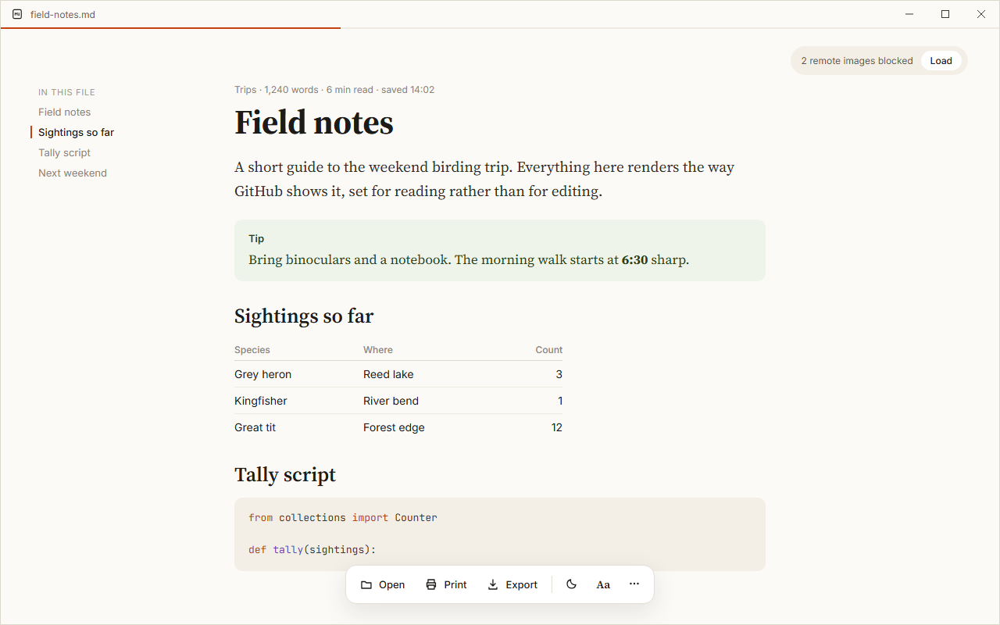
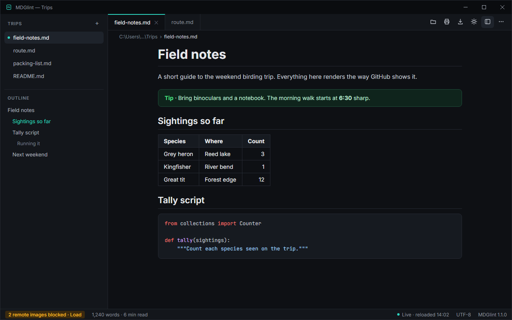
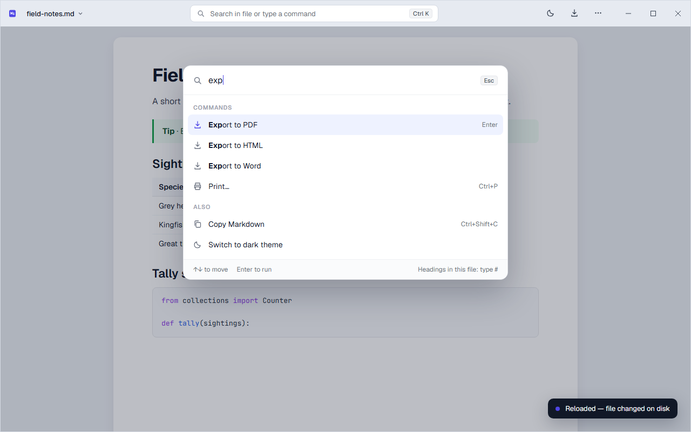

# Design mock-ups

Mock-ups made while planning a change, kept so a later release can look back at them. They are
pictures of ideas, not specs: nothing here is built until an issue says so.

## Redesign directions for #19 (planned for 1.2)

Three separate directions for the window, made on 2026-11-22 for
[#19, App design](https://github.com/Jawad-Chughtai/MDGlint/issues/19). All three show the same
sample file at 1280×800. Each has a PNG to look at and the HTML it was rendered from, which is
the editable source (open it in a browser; the fonts load from Google Fonts).

| Direction | Picture | Idea |
| --- | --- | --- |
| A · Quiet page | [quiet-page.png](redesign/quiet-page.png) ([HTML](redesign/quiet-page.html)) | A calm reading view: a cream page, a serif reading column, a thin reading-progress line, an "In this file" outline in the margin, the remote-content warning as a small pill, and one floating toolbar at the bottom (Open, Print, Export, theme, text size, More). |
| B · Workbench | [workbench.png](redesign/workbench.png) ([HTML](redesign/workbench.html)) | A dark, code-editor-style view: a sidebar with the folder's other Markdown files and a heading outline, files in tabs, a breadcrumb with icon buttons, and a status bar (blocked content, word count, last reload, version). |
| C · Command bar | [command-bar.png](redesign/command-bar.png) ([HTML](redesign/command-bar.html)) | A light Windows 11 look: one title bar with a recent-files list and a search and command box in the middle (Ctrl K), the page as a white sheet, a command palette, and a short notice when the file reloads. |

Some directions show features MDGlint doesn't have yet: the folder list, tabs and status bar in
B, the command palette and recent files in C, and the text-size control in A. Several are
already planned (outline #26, recent files #28, command bar #29, tabs #30), so picking a
direction also decides how those look.

